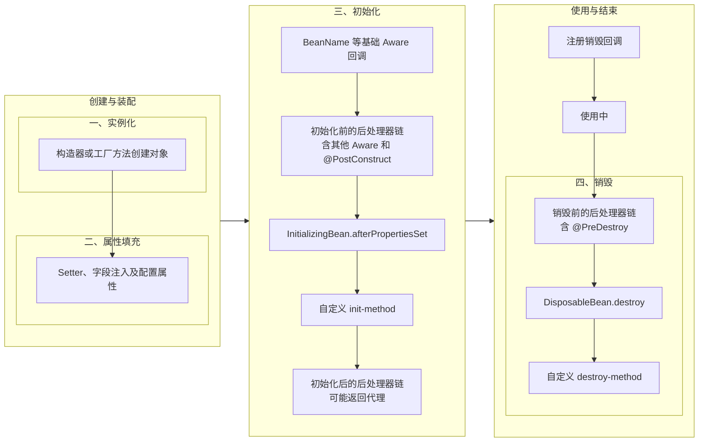
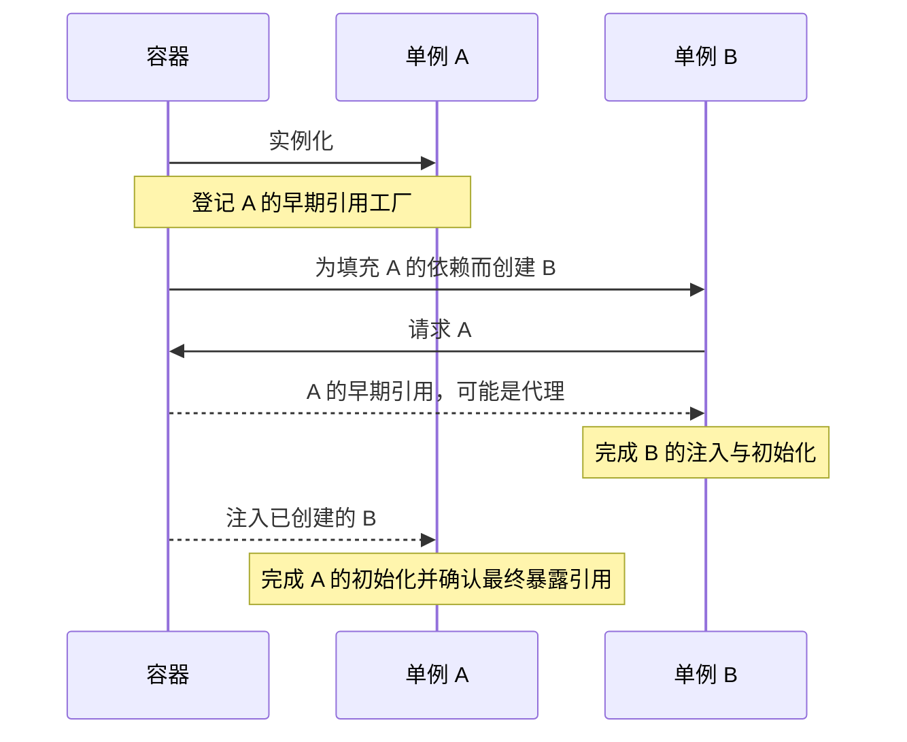

Bean 的**作用域**决定容器在什么范围内复用实例，**生命周期**描述对象从创建、依赖装配、初始化，到使用和资源清理的过程。构造器执行完只代表对象已经实例化；它还可能需要注入依赖、执行回调，并被包装为代理，才能作为容器中的 Bean 对外提供。

## 从创建到关闭

以需要销毁回调、没有循环依赖和实例化前短路的普通单例 Bean 为例：



**后处理器**是容器在指定阶段自动调用的扩展组件。`BeanPostProcessor`（Bean 后处理器）处理对象实例，它的两个基础回调围绕初始化执行；`InstantiationAwareBeanPostProcessor` 扩展了实例化前后和属性处理的介入点。

`Aware` 接口让对象接收容器信息，例如 Bean 名称和所在容器。它们与业务依赖注入、初始化回调承担不同的职责。

图中的初始化前的后处理器链包含 `ApplicationContextAware` 和 `@PostConstruct` 的处理；`@PostConstruct` 并不是在所有初始化前的后处理器执行完之后才统一调用。注册销毁回调只是记录后续清理规则，不会立即执行销毁；实际执行时机还取决于作用域和容器的关闭过程。

### 实例化与依赖注入

构造器注入和工厂方法参数注入发生在实例化阶段：容器必须先解析参数，才能调用创建入口。Setter、字段注入则在实例化之后进行。因此，不能把所有依赖注入都理解成“先调用无参构造器，再设置属性”。

普通创建路径中，`InstantiationAwareBeanPostProcessor` 的几个介入点是：

- `postProcessBeforeInstantiation()`：创建目标对象前调用。若返回非 `null` 对象，容器使用该对象，并执行初始化后的后处理器链，跳过目标对象的常规实例化、属性填充与初始化流程。
- `postProcessAfterInstantiation()`：对象已经创建，属性尚未填充。返回 `false` 会跳过该 Bean 的属性填充，不等于跳过后续初始化。
- `postProcessProperties()`：参与属性填充。`AutowiredAnnotationBeanPostProcessor` 在这个阶段处理 `@Autowired`、`@Value` 标记的字段和方法；它也参与注入构造器的选择。

组件扫描负责发现并注册 Bean 定义，注入处理器负责设置实例中的依赖。`@Autowired`、`@PostConstruct` 等注解需要对应处理器才能生效；`AnnotationConfigApplicationContext` 自动注册这些基础设施。

### Aware 回调的两处入口

Spring Framework 7.0.9 的普通创建流程中，属性填充完成后，`initializeBean()` 直接调用：

```text
BeanNameAware.setBeanName()
→ BeanClassLoaderAware.setBeanClassLoader()
→ BeanFactoryAware.setBeanFactory()
```

随后进入初始化前的后处理器链。`ApplicationContextAwareProcessor` 在链中处理 `EnvironmentAware`、`ApplicationEventPublisherAware`、`ApplicationContextAware` 等接口；生命周期注解由另一个处理器负责。

因此，“所有 Aware 都由一个方法统一调用”和“所有 Aware 都由 BeanPostProcessor 调用”都不准确。普通业务组件通常通过构造器接收业务依赖；只有确实需要容器能力时才实现相应的 Aware 接口。

## 初始化与销毁回调

### 初始化顺序

当同一个 Bean 同时配置了不同名称的三种初始化方法时，标准注解处理器下的顺序是：

```text
@PostConstruct 方法
→ InitializingBean.afterPropertiesSet()
→ 自定义 init-method / @Bean(initMethod)
```

`CommonAnnotationBeanPostProcessor` 通过其父类 `InitDestroyAnnotationBeanPostProcessor` 的 `postProcessBeforeInitialization()` 触发 `@PostConstruct`。因此，它位于初始化前的处理器链内部；自定义处理器在它之前还是之后执行，要看处理器的实际顺序。

`InitializingBean` 和自定义初始化方法则由 `initializeBean()` 中的 `invokeInitMethods()` 执行，之后才进入 `postProcessAfterInitialization()` 链。**初始化前、初始化后的“前后”，围绕的是初始化回调，不是构造器。**

三个机制都可用于初始化，但不必在业务类里同时使用。生命周期注解和配置指定的方法无需实现 Spring 专用接口；`InitializingBean` 会使组件依赖 Spring API。若同一个方法被多种生命周期机制识别，标准处理会避免重复调用，不能简单理解成“标记了几种就执行几次”。

初始化回调适合校验配置、准备对象自身的数据结构。此时当前 Bean 的必要依赖已经设置，但不代表整个容器的所有单例都已完成初始化；循环依赖中的早期引用也可能尚未初始化。需要跨组件协调的工作应放到容器启动的后续阶段。

### 销毁顺序

容器为需要清理的单例注册销毁适配器。执行销毁时，先调用适用的 `DestructionAwareBeanPostProcessor.postProcessBeforeDestruction()`，再执行接口和配置的销毁方法。

`@PreDestroy` 在销毁前的后处理器链中触发。不同名称的三种标准销毁回调按以下顺序执行：

```text
@PreDestroy 方法
→ DisposableBean.destroy()
→ 自定义 destroy-method / @Bean(destroyMethod)
```

销毁次序不等于“把初始化次序倒过来”。单例之间存在已登记的依赖关系时，容器先销毁依赖者，再销毁被依赖者，例如先清理 Service，再关闭它使用的连接池；`@DependsOn` 也可以表达需要遵守的依赖顺序。

Java 配置中的 `@Bean` 默认还会推断公开的 `close()` 或 `shutdown()` 销毁方法，`@Bean(destroyMethod = "")` 可以关闭这项推断。销毁回调用于清理资源，不等于 JVM 回收对象内存，也不能保证进程被强制终止时执行。

## 容器启动与单个 Bean 创建

`ApplicationContext.refresh()` 管理的是整个容器的启动过程，单个 Bean 的创建只是其中一部分。Spring Framework 7.0.9 中，与这些阶段相关的主线是：

```text
准备 BeanFactory 和配置定义
→ 执行 BeanFactory 后处理器
→ 注册 Bean 后处理器
→ 初始化其他容器基础设施
→ 创建剩余非懒加载单例
→ SmartInitializingSingleton 回调
→ 启动需要自动启动的生命周期组件
→ 发布 ContextRefreshedEvent
```

这不是所有 Bean 一律按图中的位置创建：后处理器等基础设施需要提前实例化，依赖解析也可能触发其他 Bean 的创建；懒加载单例和原型 Bean 可以在后续请求时创建。

### 定义处理与实例处理

`BeanFactoryPostProcessor`（Bean 工厂后处理器）在普通 Bean 创建前读取或修改配置元数据，例如调整某个 Bean 定义的属性值。它处理的是创建规则，不能为了修改定义而提前 `getBean()`，否则会让对象过早创建。

`BeanDefinitionRegistryPostProcessor` 在此基础上提供注册 Bean 定义的入口。`ConfigurationClassPostProcessor` 使用这一机制处理配置类、组件扫描、导入和 `@Bean` 声明。

`BeanPostProcessor` 处理已创建或正在创建的实例，可以执行注入、生命周期注解或代理包装。容器先处理定义，再建立实例处理器链，普通业务 Bean 才能接受这些处理。

| 扩展接口 | 操作对象 | 主要职责 |
| --- | --- | --- |
| `BeanDefinitionRegistryPostProcessor` | Bean 定义注册表 | 新增、调整定义 |
| `BeanFactoryPostProcessor` | Bean 配置元数据 | 修改创建与配置规则 |
| `BeanPostProcessor` 及扩展接口 | 对象实例 | 参与注入、初始化、销毁、代理等处理 |

通过配置类声明后处理器时，使用返回类型明确、没有业务依赖的 `static @Bean` 方法，可以避免配置类和业务依赖被过早实例化。自动发现的实例后处理器通常按 `PriorityOrdered`、`Ordered`、其他处理器分组注册；以编程方式直接添加时，主要遵循添加顺序，不能只看 `@Order` 推断整个处理器链。

### 单例创建完成后的协调

`SmartInitializingSingleton.afterSingletonsInstantiated()` 在容器完成常规非懒加载单例的预实例化后触发，适合需要这些单例都已创建的协调工作。它不是每个 Bean 初始化时都会执行的回调，也不覆盖之后才创建的懒加载单例或原型实例。

`ContextRefreshedEvent` 是容器完成刷新时发布的事件，不是某个 Bean 的初始化事件。存在多个上下文或多次刷新时，不能假设整个应用只会收到一次。

### 启动、停止与销毁

`Lifecycle` 的 `start()`、`stop()` 控制组件运行状态，例如启动或暂停消息消费。普通 `Lifecycle` 不意味着刷新容器时自动启动；`SmartLifecycle` 增加自动启动、阶段顺序和异步停止协调。

`SmartLifecycle` 的关键规则是：

- `isAutoStartup()` 决定是否随容器刷新自动启动。
- `getPhase()` 指定阶段，通常小的先启动、大的先停止；显式依赖关系仍需遵守。
- `stop(Runnable callback)` 可以异步停止，停止完成后必须执行 `callback.run()`，让容器知道该组件已停止。

启动与初始化、停止与销毁是不同操作。`context.stop()` 不会销毁全部单例，停止的组件还可以再次启动。正常关闭时，`doClose()` 先发布 `ContextClosedEvent`，再通过生命周期处理器停止组件，随后销毁单例；收到关闭事件并不代表资源已经清理完毕。刷新失败等异常路径与正常关闭不同，不能保证每次销毁之前都收到停止通知。

## 观察完整回调顺序

示例使用 [IoC 与 DI](./ioc-container-and-beans.md#示例组件类)中的 Spring Framework 7.0.9 依赖，另加生命周期注解 API：

```xml
<dependency>
  <groupId>jakarta.annotation</groupId>
  <artifactId>jakarta.annotation-api</artifactId>
  <version>3.0.0</version>
</dependency>
```

`TraceBean` 记录注入、Aware、初始化和销毁；`TracePostProcessor` 只记录名称为 `sample` 的 Bean。配置中的工厂后处理器修改 `label` 属性，说明定义处理发生在实例创建前。

<details>
<summary>完整可运行示例：代码放在 src/main/java/com/example/ 下</summary>

```java
// TraceBean.java
package com.example;

import jakarta.annotation.PostConstruct;
import jakarta.annotation.PreDestroy;
import org.springframework.beans.factory.BeanClassLoaderAware;
import org.springframework.beans.factory.BeanFactory;
import org.springframework.beans.factory.BeanFactoryAware;
import org.springframework.beans.factory.BeanNameAware;
import org.springframework.beans.factory.DisposableBean;
import org.springframework.beans.factory.InitializingBean;
import org.springframework.beans.factory.SmartInitializingSingleton;
import org.springframework.beans.factory.annotation.Autowired;
import org.springframework.context.ApplicationContext;
import org.springframework.context.ApplicationContextAware;

public class TraceBean implements BeanNameAware, BeanClassLoaderAware,
        BeanFactoryAware, ApplicationContextAware, InitializingBean,
        DisposableBean, SmartInitializingSingleton {
    private String label;

    public TraceBean() {
        System.out.println("construct");
    }

    @Autowired
    public void setDependency(AppConfig.Dependency dependency) {
        System.out.println("inject dependency");
    }

    public void setLabel(String label) {
        this.label = label;
        System.out.println("set label: " + label);
    }

    @Override
    public void setBeanName(String name) {
        System.out.println("BeanNameAware: " + name);
    }

    @Override
    public void setBeanClassLoader(ClassLoader classLoader) {
        System.out.println("BeanClassLoaderAware");
    }

    @Override
    public void setBeanFactory(BeanFactory beanFactory) {
        System.out.println("BeanFactoryAware");
    }

    @Override
    public void setApplicationContext(ApplicationContext context) {
        System.out.println("ApplicationContextAware");
    }

    @PostConstruct
    public void postConstruct() {
        System.out.println("@PostConstruct: " + label);
    }

    @Override
    public void afterPropertiesSet() {
        System.out.println("InitializingBean");
    }

    public void customInit() {
        System.out.println("custom init");
    }

    @Override
    public void afterSingletonsInstantiated() {
        System.out.println("SmartInitializingSingleton");
    }

    public void use() {
        System.out.println("use: " + label);
    }

    @PreDestroy
    public void preDestroy() {
        System.out.println("@PreDestroy");
    }

    @Override
    public void destroy() {
        System.out.println("DisposableBean");
    }

    public void customDestroy() {
        System.out.println("custom destroy");
    }
}
```

```java
// TracePostProcessor.java
package com.example;

import org.springframework.beans.PropertyValues;
import org.springframework.beans.factory.config.DestructionAwareBeanPostProcessor;
import org.springframework.beans.factory.config.InstantiationAwareBeanPostProcessor;
import org.springframework.core.PriorityOrdered;

public class TracePostProcessor implements InstantiationAwareBeanPostProcessor,
        DestructionAwareBeanPostProcessor, PriorityOrdered {
    private void trace(String beanName, String stage) {
        if (beanName.equals("sample")) {
            System.out.println(stage);
        }
    }

    @Override
    public int getOrder() {
        return HIGHEST_PRECEDENCE;
    }

    @Override
    public Object postProcessBeforeInstantiation(Class<?> beanClass, String beanName) {
        trace(beanName, "before instantiation");
        return null;
    }

    @Override
    public boolean postProcessAfterInstantiation(Object bean, String beanName) {
        trace(beanName, "after instantiation");
        return true;
    }

    @Override
    public PropertyValues postProcessProperties(PropertyValues values, Object bean, String beanName) {
        trace(beanName, "process properties");
        return values;
    }

    @Override
    public Object postProcessBeforeInitialization(Object bean, String beanName) {
        trace(beanName, "before initialization");
        return bean;
    }

    @Override
    public Object postProcessAfterInitialization(Object bean, String beanName) {
        trace(beanName, "after initialization");
        return bean;
    }

    @Override
    public boolean requiresDestruction(Object bean) {
        return bean instanceof TraceBean;
    }

    @Override
    public void postProcessBeforeDestruction(Object bean, String beanName) {
        trace(beanName, "before destruction");
    }
}
```

```java
// AppConfig.java
package com.example;

import org.springframework.beans.factory.config.BeanFactoryPostProcessor;
import org.springframework.context.annotation.Bean;
import org.springframework.context.annotation.Configuration;

@Configuration(proxyBeanMethods = false)
public class AppConfig {
    public static class Dependency {
    }

    @Bean
    public Dependency dependency() {
        return new Dependency();
    }

    @Bean(initMethod = "customInit", destroyMethod = "customDestroy")
    public TraceBean sample() {
        return new TraceBean();
    }

    @Bean
    public static BeanFactoryPostProcessor definitionProcessor() {
        return factory -> {
            System.out.println("BeanFactoryPostProcessor");
            factory.getBeanDefinition("sample").getPropertyValues()
                    .add("label", "configured");
        };
    }

    @Bean
    public static TracePostProcessor tracePostProcessor() {
        return new TracePostProcessor();
    }
}
```

```java
// App.java
package com.example;

import org.springframework.context.annotation.AnnotationConfigApplicationContext;
import org.springframework.context.event.ContextClosedEvent;
import org.springframework.context.event.ContextRefreshedEvent;

public class App {
    public static void main(String[] args) {
        try (var context = new AnnotationConfigApplicationContext()) {
            context.addApplicationListener(event -> {
                if (event instanceof ContextRefreshedEvent) {
                    System.out.println("ContextRefreshedEvent");
                } else if (event instanceof ContextClosedEvent) {
                    System.out.println("ContextClosedEvent");
                }
            });
            context.register(AppConfig.class);
            context.refresh();
            System.out.println("container ready");
            TraceBean first = context.getBean("sample", TraceBean.class);
            TraceBean second = context.getBean("sample", TraceBean.class);
            System.out.println("same: " + (first == second));
            first.use();
        }
    }
}
```

</details>

运行 `mvn compile exec:java -Dexec.mainClass=com.example.App`，本例输出：

```text
BeanFactoryPostProcessor
before instantiation
construct
after instantiation
process properties
inject dependency
set label: configured
BeanNameAware: sample
BeanClassLoaderAware
BeanFactoryAware
ApplicationContextAware
before initialization
@PostConstruct: configured
InitializingBean
custom init
after initialization
SmartInitializingSingleton
ContextRefreshedEvent
container ready
same: true
use: configured
ContextClosedEvent
before destruction
@PreDestroy
DisposableBean
custom destroy
```

这个顺序以示例的处理器、排序方式和默认同步事件分发为前提。追踪处理器使用 `PriorityOrdered`，本例在生命周期注解处理器之前执行；换成其他处理器排序后，日志中 `before initialization` 与 `@PostConstruct` 的相对位置可能改变，不能把一次运行结果当成所有自定义处理器的固定顺序。

## 代理与提前暴露的引用

### 原始对象与代理对象

Spring AOP（面向切面编程）通常通过代理拦截方法调用。普通自动代理路径中，目标对象完成依赖注入和初始化后，自动代理创建器在 `postProcessAfterInitialization()` 中决定是否包装它；`getBean()` 返回的可能是代理，销毁登记则仍针对受管理的目标对象。

初始化回调在目标对象上执行，所以不能期待给同一 Bean 的 `@PostConstruct` 方法加上 `@Transactional`，就自动获得常规代理事务。通过其他已就绪 Bean 的代理调用服务是另一种情况，还需要考虑启动阶段的依赖与执行时机。

“代理一定在初始化之后生成”也不成立：实例化前短路可以直接提供替代对象，循环依赖可能需要先生成早期代理。应区分普通自动代理路径和特殊分支。

### 循环依赖与三级缓存

当单例 A 与 B 通过 Setter 或字段相互依赖，并且容器允许循环引用时，A 可以先实例化、尚未完成属性填充就暴露早期引用。B 注入该引用后完成创建，A 再拿到 B 完成自己的流程。



Spring Framework 7.0.9 的 `DefaultSingletonBeanRegistry` 使用三个相关缓存：

| 常用称呼 | 字段 | 保存内容 |
| --- | --- | --- |
| 一级缓存 | `singletonObjects` | 完成创建流程的共享实例或最终暴露的代理 |
| 二级缓存 | `earlySingletonObjects` | 已经取得的早期引用，可能是代理 |
| 三级缓存 | `singletonFactories` | 生成早期引用的 `ObjectFactory`，不是最终 Bean 实例 |

实例化之后、属性填充之前，容器可以登记早期引用工厂。只有发生早期引用请求时，才调用工厂取得引用并存入二级缓存；完成创建后，最终对象进入一级缓存，对应的早期缓存被清理。没有循环引用请求的单例不需要依次经过三个缓存。

三级缓存的作用是延迟决定暴露哪个早期引用。`SmartInstantiationAwareBeanPostProcessor.getEarlyBeanReference()` 可以让自动代理创建器提供早期代理，后续创建结束时需要与最终暴露引用保持一致，避免一个依赖拿到原始对象、另一个依赖拿到代理。并非任意自定义包装或任意循环关系都能满足这个条件。

这套机制存在边界：

- **纯构造器循环依赖**：A 的实例尚未产生，就必须先创建 B，无法登记 A 的早期引用工厂；不能靠三级缓存解决。
- **纯原型 Bean 的直接循环依赖**：没有上述单例早期引用缓存机制，通常创建失败。
- **禁止循环引用的容器**：不会按这条路径提前暴露对象。Spring Framework 的工厂默认允许尝试处理循环引用；Spring Boot 的 `spring.main.allow-circular-references` 默认是 `false`，两者的默认设置不能混用。

`@Lazy` 注入点或 `ObjectProvider` 可以把实际依赖获取推迟，改变原本的创建关系；它们不是让纯构造器循环本身突然可以被三级缓存解决。更直接的处理通常是调整职责、抽取共同依赖，消除互相依赖。

## singleton 与 prototype

### singleton：复用共享实例

`singleton` 是默认作用域，**同一个容器中，同一份 Bean 定义对应一个共享实例**。上例两次获取 `sample`，返回同一个对象。

单例的范围由容器和 Bean 定义共同决定。同一个类注册为不同名称的多个 Bean，可以产生多个实例。单例不保证业务方法线程安全，共享可变状态仍需要并发控制。

单例也不等于启动时立即创建：普通非懒加载单例随容器启动预实例化；懒加载单例在需要时创建，但若被非懒加载单例直接依赖，仍可能在启动时因依赖解析而创建。

### prototype：每次请求创建实例

在示例 `AppConfig.sample()` 上增加 `@Scope("prototype")`，并导入 `org.springframework.context.annotation.Scope`。容器不再在启动时预实例化 `sample`，两次 `getBean()` 各自执行创建、依赖注入、Aware 和初始化流程，`same` 输出 `false`。

**原型 Bean 会执行初始化回调，但容器不自动执行其销毁回调**，包括 `@PreDestroy`、`DisposableBean` 和自定义销毁方法。对象持有需要释放的资源时，由调用方负责清理；也不会因为实现 `SmartInitializingSingleton` 就收到预实例化单例完成的回调。

| 作用域 | 实例复用 | 初始化 | 容器自动销毁 |
| --- | --- | --- | --- |
| `singleton` | 同一容器、同一 Bean 定义共享实例 | 实例创建时执行 | 正常关闭容器等销毁路径中执行 |
| `prototype` | 每次请求按定义创建实例 | 每个新实例都执行 | 不执行，由调用方负责清理 |

### 单例依赖原型 Bean

单例通过构造器直接注入原型 Bean 时，容器创建单例所需的那次依赖解析只提供一个原型实例。单例随后一直持有它，不会在每次业务调用时重新注入。

需要每次使用时获取新实例，可以注入 `ObjectProvider<T>`，在业务调用中执行 `getObject()`。它是按需获取 Bean 的提供器：获取的是单例还是新实例，仍由目标 Bean 的作用域决定。

### Web 作用域

`request`、`session`、`application` 分别按 HTTP 请求、会话和 `ServletContext`（Web 应用的 Servlet 上下文）复用实例；`application` 的范围与单个 Spring 容器的单例不同，一个 Servlet 上下文可以包含多个 Spring 容器。Spring 的 WebSocket 消息处理还提供 `websocket` 会话作用域。

这些作用域需要相应的 Web 环境。容器对 Web 作用域的销毁管理依赖该作用域的结束回调，不能一律套用“容器关闭时销毁”。

## 注解与配置类中的写法

### 组件注解

组件扫描注册 Bean 后，`@Scope` 指定作用域，`@PostConstruct`、`@PreDestroy` 标记初始化和销毁方法。Spring 7 使用 `jakarta.annotation` 包中的生命周期注解；只创建一个普通 Java 对象不会触发这些容器回调。

作用域配置和注解处理是两件事：即使原型组件的方法标注了 `@PreDestroy`，容器也不会自动调用它。

### Java 配置类

示例中的 `@Bean(initMethod = "customInit", destroyMethod = "customDestroy")` 指定普通 Java 方法。`@Scope` 放在 `@Bean` 方法上时，配置的是该方法对应 Bean 定义的作用域。

XML 中的声明可以写成：

```xml
<bean id="sample" class="com.example.TraceBean"
      scope="singleton"
      init-method="customInit" destroy-method="customDestroy"/>
```

这只展示作用域和自定义回调的对应写法；若用 XML 运行完整示例，还需要声明依赖、后处理器并开启注解处理。

| 配置位置 | 作用域 | 初始化回调 | 销毁回调 |
| --- | --- | --- | --- |
| XML 的 `<bean>` | `scope` | `init-method` | `destroy-method` |
| 组件类 | `@Scope` | `@PostConstruct` | `@PreDestroy` |
| 配置类的 `@Bean` 方法 | `@Scope` | `@Bean(initMethod = "...")` | `@Bean(destroyMethod = "...")` |

## 创建流程的源码入口

下面的调用关系对应 Spring Framework 7.0.9 的实现，省略了缓存命中、父容器、异常处理和特殊对象分支。阅读时沿当前问题定位，不必把每个内部方法当成独立的生命周期阶段。

```text
AbstractApplicationContext.refresh()
  invokeBeanFactoryPostProcessors()
  registerBeanPostProcessors()
  finishBeanFactoryInitialization()
    DefaultListableBeanFactory.preInstantiateSingletons()
      AbstractBeanFactory.doGetBean()
        AbstractAutowireCapableBeanFactory.createBean()
          resolveBeforeInstantiation()     // 可短路常规创建
          doCreateBean()
            createBeanInstance()
            applyMergedBeanDefinitionPostProcessors()
            addSingletonFactory()          // 满足早期暴露条件时
            populateBean()
            initializeBean()
              invokeAwareMethods()
              applyBeanPostProcessorsBeforeInitialization()
              invokeInitMethods()
              applyBeanPostProcessorsAfterInitialization()
            registerDisposableBeanIfNecessary()
        DefaultSingletonBeanRegistry.addSingleton()
      SmartInitializingSingleton.afterSingletonsInstantiated()
  finishRefresh()
    LifecycleProcessor.onRefresh()
    publishEvent(ContextRefreshedEvent)
```

普通单例最终入缓存发生在外层单例获取流程，不能理解成 `initializeBean()` 直接把对象放入一级缓存。`FactoryBean` 也是特殊分支：它本身是受管理的 Bean，`getObject()` 生产的对象与工厂自身不能套用完全相同的创建、初始化与销毁流程。
