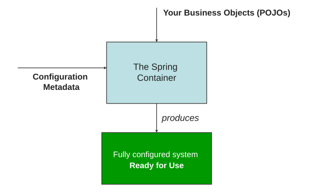

一个用户查询功能通常需要请求处理、业务逻辑和数据访问等对象协作。除了实现各自的方法，应用还要创建这些对象、连接它们的依赖，并在适当的时候初始化和释放资源。

Spring 的 IoC 容器承担对象的创建、配置与组装工作。应用提供组件类和配置，容器据此构建可协作的对象。

## 组件、Bean 与容器

组件是承担某项功能的对象，例如处理请求的 Controller、实现业务逻辑的 Service、访问数据的 DAO（Data Access Object，数据访问对象），以及数据库连接池。

这些对象交给 Spring 容器管理后，称为 **Bean**。例如，`UserService` 是组件类，容器管理的 `UserService` 实例是 Bean。用户、订单等业务数据对象，通常由业务逻辑或数据访问层按需要创建和加载。

容器的职责可以分为三个方面：

- **创建与配置对象**：根据配置选择对象类型、创建方式和所需的属性值。
- **组装依赖关系**：将一个对象需要的协作对象提供给它，例如把 `UserDao` 交给 `UserService`。
- **管理生命周期**：按照对象的配置和作用域，在适当的阶段执行初始化、销毁等回调。

集合可以保存对象引用；Spring 容器还要知道对象如何创建、依赖谁、如何管理。应用因此需要提供**配置元数据**，也就是描述这些规则的信息。

## IoC 与 DI 的关系

如果 `UserService` 在内部通过 `new UserDao()` 创建依赖，服务就同时决定了业务行为和依赖的创建方式。改为由构造器接收 `UserDao` 后，创建和选择依赖的工作移到了服务之外。

手动组装一个服务时，应用入口可以这样创建对象：

```java
UserDao userDao = new UserDao();
UserService userService = new UserService(userDao);
```

这里包含两项工作：创建对象，以及将 `userDao` 传给依赖它的 `userService`。交给 Spring 后，这些工作由容器依据配置完成。

**控制反转**（Inversion of Control，IoC）是一种设计思想，描述控制权的转移。在 Spring 容器管理对象的场景中，业务对象的创建、配置和依赖组装交由容器控制，业务代码使用已组装好的对象。

**依赖注入**（Dependency Injection，DI）描述依赖的提供方式：对象声明自己需要哪些协作对象，由外部通过构造器、工厂方法参数或属性设置提供。它是 Spring 实现控制反转的主要方式。

以 `UserService` 为例，它通过构造器声明需要 `UserDao`；容器创建服务时，将配置中引用的 `UserDao` 实例传入。服务仍然依赖数据访问对象，但无需在内部决定如何创建它。

IoC 关注对象的创建和组装由谁控制，DI 关注依赖如何交给对象，IoC 容器则是执行这些管理工作的设施。前面的手动代码也使用了构造器注入；依赖注入这个设计方式本身不要求 Spring。

## 从配置到可用的 Bean

容器需要两类输入：**组件类**描述对象能做什么，**配置元数据**描述容器应该管理哪些对象、怎样创建和连接它们。容器读取配置并完成组装后，应用可以获取 Bean 并调用业务方法。



### 示例组件类

XML 示例使用 `UserDao` 和 `UserService`：容器创建 `UserDao`，把它交给 `UserService`，应用获取服务并查询姓名。

示例使用 Spring Framework 7.0.9，需要 JDK 17 或更高版本；[Maven 项目](../engineering/maven.md)的 `<dependencies>` 中添加：

```xml
<dependency>
  <groupId>org.springframework</groupId>
  <artifactId>spring-context</artifactId>
  <version>7.0.9</version>
</dependency>
```

`UserDao` 用固定数据模拟查询，`UserService` 通过构造器接收它。代码放在 `src/main/java/com/example/` 下。

```java
// UserDao.java
package com.example;

public class UserDao {
    public String findName() {
        return "Ada";
    }
}
```

```java
// UserService.java
package com.example;

public class UserService {
    private final UserDao userDao;

    public UserService(UserDao userDao) {
        this.userDao = userDao;
    }

    public String findName() {
        return userDao.findName();
    }
}
```

这两个类只描述业务行为和对象依赖。选择怎样创建它们、使用哪个对象满足依赖，是配置的职责。

### 用配置连接依赖

在 `src/main/resources/beans.xml` 中声明两个 Bean：

```xml
<?xml version="1.0" encoding="UTF-8"?>
<beans xmlns="http://www.springframework.org/schema/beans"
       xmlns:xsi="http://www.w3.org/2001/XMLSchema-instance"
       xsi:schemaLocation="http://www.springframework.org/schema/beans
           https://www.springframework.org/schema/beans/spring-beans.xsd">

  <bean id="userDao" class="com.example.UserDao"/>

  <bean id="userService" class="com.example.UserService">
    <constructor-arg ref="userDao"/>
  </bean>
</beans>
```

`<bean>` 声明需要容器管理的对象：`id` 是 Bean 的标识，`class` 是组件类的全限定名。`<constructor-arg ref="userDao"/>` 表示使用名为 `userDao` 的 Bean 作为构造器参数。

### 创建容器并获取 Bean

`ClassPathXmlApplicationContext` 从类路径读取 XML 配置。Maven 将 `src/main/resources/beans.xml` 复制到运行时类路径，因此构造器中使用 `"beans.xml"`。

```java
// App.java
package com.example;

import org.springframework.context.support.ClassPathXmlApplicationContext;

public class App {
    public static void main(String[] args) {
        try (var context = new ClassPathXmlApplicationContext("beans.xml")) {
            UserService service = context.getBean("userService", UserService.class);
            System.out.println(service.findName());
        }
    }
}
```

在项目根目录运行：

```bash
mvn compile exec:java -Dexec.mainClass=com.example.App
```

程序输出 `Ada`。本例没有配置延迟初始化，两个 Bean 都采用默认的单例作用域，容器初始化时会创建并组装它们。`getBean()` 获取已经可用的服务，随后由应用调用业务方法；`try` 块结束时关闭容器，触发适用的销毁回调。

这次应用入口只提供配置并获取服务；创建 `UserDao`、创建 `UserService` 并传入依赖的工作由容器完成。服务的构造器和查询方法保持原样。

XML 的属性配置、普通值注入和工厂方法配置，见 [XML 配置](./xml-config.md)。

## Bean 定义与 Bean 实例

配置描述的是创建和管理对象的规则，容器内部用 `BeanDefinition`（Bean 定义）保存这些规则。Bean 定义可以记录类型、构造器参数、作用域和生命周期方法等信息；根据定义创建出的对象是 Bean 实例。

XML 示例中的 `userService` 定义描述了“创建 `UserService`，构造器参数引用 `userDao`”。它既描述对象本身，也描述对象之间的关系。

默认的 `singleton`（单例）作用域意味着：**同一个容器中，同一份 Bean 定义对应一个共享实例**。在前面的 `try` 块中重复获取 `userService`，会得到同一个对象：

```java
UserService first = context.getBean("userService", UserService.class);
UserService second = context.getBean("userService", UserService.class);
System.out.println(first == second); // true
```

单例的范围由容器和 Bean 定义共同决定。同一个类也可以配置成不同名称的多个 Bean。本例中的构造器配置会为不同容器创建各自的实例；若采用返回共享对象的工厂方法，不同容器也可能引用同一个对象。

不同作用域下的实例复用，以及初始化、销毁回调的执行边界，见 [Bean 的作用域与生命周期](./bean-scopes-and-lifecycle.md)。

## 容器接口与 Bean 获取

`BeanFactory` 是 Spring 的基础容器接口，定义了获取 Bean 等能力。`ApplicationContext` 继承它，并提供资源访问、应用事件和国际化消息等功能。应用通常使用 `ApplicationContext` 的具体实现。

常见实现按配置来源区分：

| 实现类                               | 配置来源                                    |
| ------------------------------------ | ------------------------------------------- |
| `ClassPathXmlApplicationContext`     | 类路径中的 XML 文件                         |
| `FileSystemXmlApplicationContext`    | 文件系统中的 XML 文件                       |
| `AnnotationConfigApplicationContext` | Java 配置类或组件类，也支持按指定包扫描组件 |

容器提供三种常用的获取方式：

| 调用                                        | 含义                                   |
| ------------------------------------------- | -------------------------------------- |
| `getBean("userService")`                    | 按名称获取，返回类型是 `Object`        |
| `getBean(UserService.class)`                | 按类型获取，需要能够确定一个候选 Bean  |
| `getBean("userService", UserService.class)` | 按名称定位，并检查对象是否符合指定类型 |

名称不存在、类型不匹配，或按类型获取时无法确定一个候选 Bean，都会抛出相应异常。组件之间已经声明的依赖由容器注入，业务对象直接使用这些依赖。

## 配置元数据的声明方式

前面的 XML 把对象类型和依赖关系写在组件类之外。同样的组装规则也可以通过注解配置或 Java 配置类表达：

| 声明方式                                  | Bean 从哪里注册                      | 依赖如何表达                                 |
| ----------------------------------------- | ------------------------------------ | -------------------------------------------- |
| [XML 配置](./xml-config.md)               | XML 中的 `<bean>` 元素               | 构造器参数、属性中的引用或值                 |
| [注解配置](./annotation-config-and-di.md) | 扫描带有 `@Component` 等组件注解的类 | 构造器参数或 `@Autowired` 等注解标记的注入点 |
| [Java 配置类](./java-config.md)           | 配置类中的 `@Bean` 工厂方法          | 工厂方法参数或方法内的组装代码               |

组件扫描和 Java 配置类都使用注解，也可以在同一个容器中配合使用，例如扫描业务组件，再用 `@Bean` 注册数据库连接池。注册 Bean 和为 Bean 提供依赖是两项工作：`@Component` 等标记用于发现组件，`@Autowired` 用于标记自动注入的位置。
