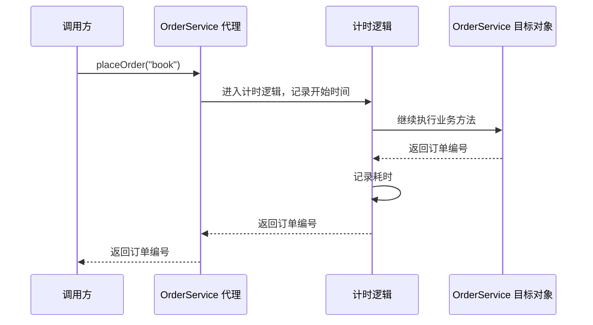

多个业务方法都需要记录耗时、检查权限或参与事务时，把这些逻辑分别写进每个方法，会让业务代码和公共处理混在一起。**面向切面编程**（Aspect-Oriented Programming，AOP）把这类跨越多个组件的行为集中定义，再指定它们应用到哪些方法。

Spring AOP 通过**代理对象**实现这一点：调用方先调用代理，代理执行匹配的附加逻辑，再调用原来的业务对象。[IoC 容器](./ioc-container-and-beans.md)负责管理和组装对象，AOP 则在方法调用经过代理时添加行为。

## 从一次方法调用理解 AOP

假设 `OrderService.placeOrder()` 负责创建订单，现在需要统计这次调用的耗时。业务方法保留订单逻辑，计时代码放在外层：



图中的目标对象就是承载业务逻辑的 `OrderService` 实例。调用方拿到的是代理引用，仍然按原来的方式调用 `placeOrder()`；代理把计时逻辑接入调用过程。计时逻辑也可以在方法抛出异常时执行，随后继续向调用方传播异常。

把切面行为接入目标对象的过程称为**织入**（Weaving），Spring AOP 在运行时通过代理完成。另一项能力是**引入**（Introduction）：让代理额外实现目标类原本没有的接口，并提供对应实现；计时示例没有使用它。

Spring 文档列出八个核心术语，可结合这条流程理解：

| 术语                      | 含义与示例                                                                 |
| ------------------------- | -------------------------------------------------------------------------- |
| 连接点（Join Point）      | 可以加入附加逻辑的位置；Spring AOP 中是方法执行                            |
| 切点（Pointcut）          | 匹配规则，例如选择 `OrderService` 的所有公开方法                           |
| 通知（Advice）            | 在匹配位置执行的逻辑，例如记录开始时间和耗时                               |
| 切面（Aspect）            | 将切点与通知组织在一起的模块，例如计时切面                                 |
| 目标对象（Target Object） | 被代理的业务对象，即 `OrderService` 实例                                   |
| AOP 代理（AOP Proxy）     | 调用方实际使用的入口，负责把通知与业务调用连接起来                         |
| 织入（Weaving）           | 把切面与目标对象关联起来，使计时逻辑参与方法调用的过程                     |
| 引入（Introduction）      | 为代理增加接口及实现，例如让订单服务的代理额外实现状态查询接口；本例未使用 |

切点决定“哪些方法”，通知决定“做什么、何时做”，切面负责组织它们。这里的“通知”是 AOP 的术语，与事件发布或消息通知无关。

## 一个可运行的计时切面

示例使用 Spring Framework 7.0.9 和 JDK 17，通过[Java 配置类](./java-config.md)注册 Bean。可使用 [Maven 笔记](../engineering/maven.md#完成一次构建)中的项目骨架，在 `pom.xml` 中添加：

```xml
<dependencies>
  <dependency>
    <groupId>org.springframework</groupId>
    <artifactId>spring-context</artifactId>
    <version>7.0.9</version>
  </dependency>
  <dependency>
    <groupId>org.aspectj</groupId>
    <artifactId>aspectjweaver</artifactId>
    <version>1.9.24</version>
  </dependency>
</dependencies>
```

`spring-context` 会传递引入 `spring-aop`。`aspectjweaver` 提供这里使用的 AspectJ 注解和切点解析支持；加入这个依赖并不意味着应用已经启用字节码织入。

下面四个文件放在 `src/main/java/com/example/aop/` 下。

### 业务对象

```java
// OrderService.java
package com.example.aop;

public class OrderService {
    public String placeOrder(String product) {
        if (product == null || product.isBlank()) {
            throw new IllegalArgumentException("商品不能为空");
        }
        return "order-" + product;
    }
}
```

方法用返回固定格式的编号模拟创建订单，不包含计时逻辑。

### 切点与环绕通知

`@Aspect` 声明切面类。`@Around` 声明**环绕通知**：它包住一次方法调用，可以在调用前后执行逻辑，并控制是否继续调用。

`ProceedingJoinPoint` 表示可继续执行的当前调用；`proceed()` 将控制权交给后续通知，最终到达目标方法。当前只有一个通知，因此它会直接继续执行业务方法。

```java
// TimingAspect.java
package com.example.aop;

import org.aspectj.lang.ProceedingJoinPoint;
import org.aspectj.lang.annotation.Around;
import org.aspectj.lang.annotation.Aspect;

@Aspect
public class TimingAspect {
    @Around("execution(public * com.example.aop.OrderService.*(..))")
    public Object measure(ProceedingJoinPoint joinPoint) throws Throwable {
        long start = System.nanoTime();
        try {
            return joinPoint.proceed();
        } finally {
            long elapsed = System.nanoTime() - start;
            System.out.println(joinPoint.getSignature().getName()
                    + " 耗时 " + elapsed + " ns");
        }
    }
}
```

表达式 `execution(public * com.example.aop.OrderService.*(..))` 匹配 `OrderService` 的公开方法，不限制返回类型、方法名和参数列表。

`return joinPoint.proceed()` 保留原来的返回值，`throws Throwable` 允许原异常继续传播，`finally` 保证正常返回和异常退出都经过计时代码。开始时间保存在局部变量中，避免并发调用共享同一个计时字段。

### 注册 Bean 并启用代理

```java
// AppConfig.java
package com.example.aop;

import org.springframework.context.annotation.Bean;
import org.springframework.context.annotation.Configuration;
import org.springframework.context.annotation.EnableAspectJAutoProxy;

@Configuration
@EnableAspectJAutoProxy
public class AppConfig {
    @Bean
    public OrderService orderService() {
        return new OrderService();
    }

    @Bean
    public TimingAspect timingAspect() {
        return new TimingAspect();
    }
}
```

`@EnableAspectJAutoProxy` 启用基于 `@Aspect` 的自动代理支持。容器识别切面，并为需要应用通知的 Bean 创建代理。

`@Aspect` 本身不会把类注册为 Bean。这里通过 `@Bean` 注册；采用[组件扫描](./annotation-config-and-di.md)时，也可以在切面类上组合 `@Aspect` 与 `@Component`。

### 从容器获取并调用

```java
// App.java
package com.example.aop;

import org.springframework.context.annotation.AnnotationConfigApplicationContext;

public class App {
    public static void main(String[] args) {
        try (var context = new AnnotationConfigApplicationContext(AppConfig.class)) {
            OrderService service = context.getBean(OrderService.class);
            System.out.println(service.placeOrder("book"));
            try {
                service.placeOrder("");
            } catch (IllegalArgumentException e) {
                System.out.println(e.getMessage());
            }
        }
    }
}
```

在项目根目录运行：

```bash
mvn compile exec:java -Dexec.mainClass=com.example.aop.App
```

输出形如：

```text
placeOrder 耗时 123456 ns
order-book
placeOrder 耗时 23456 ns
商品不能为空
```

两次调用各产生一条耗时记录，第二次的异常仍由调用方捕获。耗时数值每次不同，这个示例只演示拦截流程，不构成性能基准。计时范围是 `proceed()` 包围的同步调用过程；若方法返回异步任务，它不等于异步任务完成所需的时间。

## 通知如何控制调用过程

环绕通知之外，Spring 还提供按执行时机划分的通知：

| 注解              | 执行时机                     | 对调用的影响                                               |
| ----------------- | ---------------------------- | ---------------------------------------------------------- |
| `@Before`         | 目标方法执行前               | 通知正常结束后继续；抛出异常会阻止后续执行                 |
| `@AfterReturning` | 目标方法正常返回后           | 可通过 `returning` 绑定返回值，不能用通知的返回值替换结果  |
| `@AfterThrowing`  | 目标方法抛出匹配类型的异常后 | 可通过 `throwing` 绑定异常；不是把异常转成正常结果的处理器 |
| `@After`          | 目标方法退出后               | 类似 `finally`，覆盖正常返回与异常退出                     |
| `@Around`         | 包围调用                     | 控制是否继续调用，也可以改变参数、返回值或异常             |

只需要调用前检查时可以使用 `@Before`；需要跨越调用前后共享开始时间时，使用环绕通知。环绕通知不执行 `proceed()`，后续通知和目标方法就不会执行；执行多次则可能重复执行业务操作。

### 多个切面的顺序

多个切面匹配同一个方法时，通知组成调用链。可在切面类上使用 `org.springframework.core.annotation.Order` 声明优先级，数值越小，优先级越高。

假设 A 为 `@Order(1)`、B 为 `@Order(2)`，两者都是环绕通知，均调用一次 `proceed()`，且方法正常返回：

```text
A 调用前 → B 调用前 → 目标方法 → B 调用后 → A 调用后
```

优先级高的通知处于外层。计时切面放在外层时会包含内层通知的耗时，所以顺序会影响观测范围。没有指定优先级时，不应依赖多个切面的执行顺序，也不要根据源码中方法的排列推断同类通知的顺序。

## 按方法签名或注解选择切点

### 方法签名与命名切点

`execution` 根据方法签名匹配。常用形式为：

```text
execution(修饰符? 返回类型 声明类型?方法名(参数列表) 异常类型?)
```

`?` 表示该部分可省略，不是表达式中的实际字符。示例中的 `public` 限定公开方法，返回类型位置的 `*` 表示任意返回类型，方法名位置的 `*` 表示任意名称，参数位置的 `..` 表示零个或多个任意类型参数。

同一条规则被多个通知使用时，可以用 `@Pointcut` 命名。在 `TimingAspect` 中引入 `org.aspectj.lang.annotation.Pointcut`，添加方法：

```java
@Pointcut("execution(public * com.example.aop.OrderService.*(..))")
public void orderOperations() {}
```

把计时方法上的注解改为 `@Around("orderOperations()")`，即可复用规则。`orderOperations()` 的空方法体不承担业务行为，只为切点提供名称。

### 用自定义注解选择方法

按类和方法名匹配适合结构规则；只想为少量指定方法计时时，可以声明标记注解：

```java
// Timed.java
package com.example.aop;

import java.lang.annotation.ElementType;
import java.lang.annotation.Retention;
import java.lang.annotation.RetentionPolicy;
import java.lang.annotation.Target;

@Target(ElementType.METHOD)
@Retention(RetentionPolicy.RUNTIME)
public @interface Timed {
}
```

在 `OrderService.placeOrder()` 上添加 `@Timed`，并把计时通知的切点替换为：

```java
@Around("@annotation(com.example.aop.Timed)")
```

`@annotation` 匹配被调用方法上的注解；`RUNTIME` 让注解在运行时可读取。注解只是标记，代理和通知才负责执行计时。

规则还可以组合。例如 `execution(public * *(..)) && @annotation(com.example.aop.Timed)` 同时要求公开方法和指定注解。`&&`、`||`、`!` 分别表达且、或、非。

## 代理方式决定拦截边界

### JDK 动态代理与 CGLIB

Spring AOP 使用两种代理方式。JDK 动态代理创建实现目标接口的代理对象；CGLIB 通过生成目标类的子类创建代理。

在上面的 `@EnableAspectJAutoProxy` 默认配置下，有接口的目标通常使用 JDK 动态代理，没有接口的目标使用 CGLIB。示例的 `OrderService` 没有接口，因此得到的是类代理，可以按 `OrderService` 类型获取。

| 代理方式     | 调用入口               | 主要约束                                              |
| ------------ | ---------------------- | ----------------------------------------------------- |
| JDK 动态代理 | 代理暴露的接口方法     | 代理不是实现类的子类，应按接口类型注入和使用          |
| CGLIB 类代理 | 代理子类可以重写的方法 | 不能代理 `final` 类，不能增强 `final`、`private` 方法 |

需要强制使用类代理时，可以设置 `@EnableAspectJAutoProxy(proxyTargetClass = true)`。这不会解除 `final` 或 `private` 的限制，也不会使静态方法具备实例代理拦截能力。

Spring Boot 的 AOP 自动配置默认使用类代理，可以通过 `spring.aop.proxy-target-class=false` 切回基于接口的代理策略。相关依赖满足且自动配置生效时，通常不需要再显式添加 `@EnableAspectJAutoProxy`。因此，不能只根据“目标实现了接口”判断 Boot 应用的实际代理类型。

### 同一个对象内部的调用绕过代理

在示例的 `OrderService` 中增加：

```java
public String placeTwoOrders() {
    return placeOrder("book") + "," + placeOrder("pen");
}
```

保留最初匹配 `OrderService` 所有公开方法的切点，从容器取得 `service` 后调用 `service.placeTwoOrders()`，只会记录一次 `placeTwoOrders` 的耗时。

外部调用经过代理，但目标对象内部的 `placeOrder()` 相当于 `this.placeOrder()`，调用发生在目标对象上，没有重新经过代理，因此不会产生两条独立的 `placeOrder` 计时记录。如果切点只匹配 `placeOrder()`，这次外部调用就完全没有计时通知。

需要让内部操作形成独立的拦截边界时，可以把它提取到另一个 Bean，再通过注入的 Bean 引用调用。切换成 CGLIB 不能解决自调用问题。

### 手动创建的对象没有自动代理

`new OrderService().placeOrder("book")` 调用的是普通实例，不经过容器提供的代理，因此不会触发本例的切面。业务代码应使用注入或从容器获取的 Bean 引用。

这与配置类中的 `@Bean` 方法执行 `new OrderService()` 不同：后者将对象交给容器，容器还有机会为它创建代理。

## Spring AOP 与 AspectJ 的边界

Spring AOP 在运行时通过代理织入；AspectJ 还支持在编译时或类加载时修改字节码，可以覆盖构造器、字段访问等更广的连接点，也不受代理自调用边界的约束。

Spring AOP 借用了 AspectJ 的注解形式和切点表达式，但 `@Aspect`、`@EnableAspectJAutoProxy` 以及 `aspectjweaver` 依赖的组合，仍然可以完全运行在 Spring 的代理机制上。是否进行了字节码织入，取决于是否另外配置了相应的编译或类加载流程。

`@Transactional`、`@Cacheable` 等声明式能力在常见的代理模式下也依赖调用经过代理；它们由各自的基础设施提供通知，不要求业务代码再编写一个 `@Aspect`。理解调用边界后，再分别学习事务传播、缓存规则等具体语义。

## 切面未执行时的检查顺序

1. **对象来源**：目标对象和切面是否已注册为 Bean，调用方拿到的是否是容器提供的引用。
2. **代理配置**：是否启用了 `@EnableAspectJAutoProxy`，或已有生效的 Boot AOP 自动配置；使用 `@Aspect` 时所需依赖是否齐全。
3. **切点匹配**：包名、类型、方法签名或注解是否与规则一致。
4. **调用路径**：调用是否来自代理外部，还是同一个对象里的 `this` 调用。
5. **方法可代理性**：是否受接口暴露范围或类代理的 `final`、`private` 等限制。
6. **通知控制流**：外层环绕通知是否调用了 `proceed()`，前置通知是否已经抛出异常。
